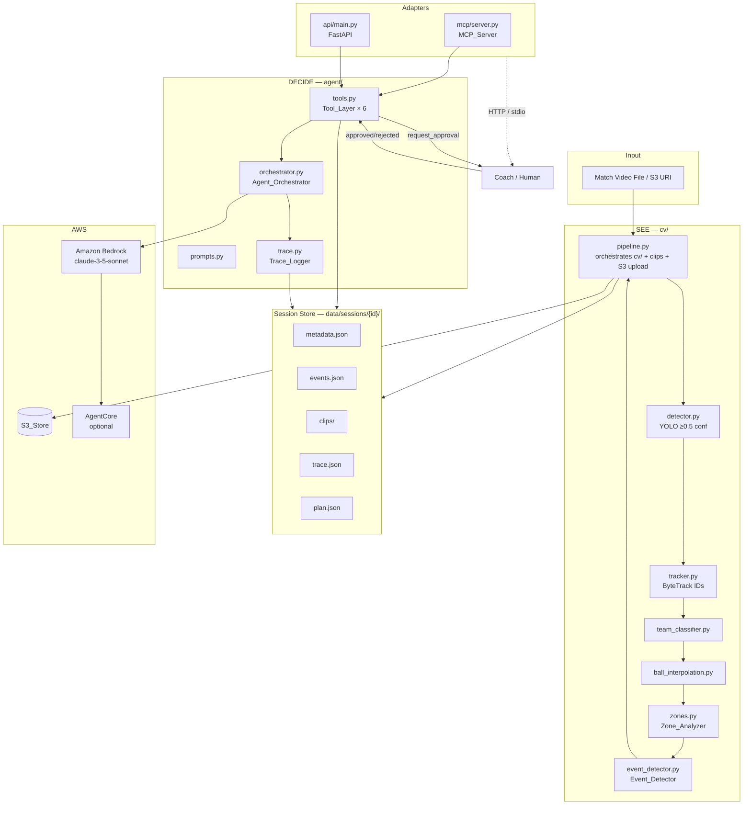

# Design Document: TactiFrame — Hackathon Repository

## Overview

TactiFrame is an Agentic Vision system for football (soccer) opposition analysis, built as a hackathon entry for the OpenCV AI Competition 2026 (Agentic Vision track with AWS). The system converts raw match video footage into evidence-backed tactical intelligence through a four-phase pipeline:

**SEE → UNDERSTAND → DECIDE → ACT / COACH APPROVAL**

| Phase | What happens | Primary module |
|---|---|---|
| SEE | OpenCV 5 + YOLO detects players and ball; ByteTrack assigns persistent IDs; Zone_Analyzer maps positions to pitch zones | `cv/` |
| UNDERSTAND | Event_Detector converts frame-level tracks into discrete football events (pass, shot, press…); evidence clips are extracted and uploaded to S3 | `cv/event_detector.py`, `cv/pipeline.py` |
| DECIDE | Agent_Orchestrator drives a multi-step reasoning loop via Amazon Bedrock (Converse API), calling the six Tool_Layer functions to form hypotheses, gather evidence, and draft a tactical plan | `agent/` |
| ACT | The drafted plan is presented to the Coach via the Approval_Gate; the Trace_Logger serialises the full reasoning trace to JSON for judge review | `agent/trace.py`, `api/` |

The repository forks the existing [TactiScout-CV](https://github.com/Marouan-balha/TactiScout-CV) base (detector, tracker, team classifier, ball interpolation, pipeline), extending it under `cv/` without rewriting proven components.

---

## Architecture



### Key Design Decisions

1. **Single Tool_Layer** — All business logic lives in `agent/tools.py`. Both the MCP server and the FastAPI endpoints are thin adapters that import and delegate; no logic is duplicated.

2. **Bedrock Converse API** — The Agent_Orchestrator uses `bedrock_runtime.converse()` with a `toolConfig` spec. When Claude returns `stopReason == "tool_use"`, the orchestrator dispatches locally to Tool_Layer functions and feeds results back as `toolResult` messages. This gives a clean, model-agnostic loop that can swap foundation models by changing `modelId`.

3. **AgentCore opt-in** — If the `AGENTCORE_ENABLED` env var is set and the `bedrock-agentcore` boto3 client is available, the orchestrator routes tool dispatch through AgentCore; otherwise it executes tools locally. This avoids a hard dependency while demonstrating the capability.

4. **Session files over a database** — For a hackathon, file-based sessions under `data/sessions/{session_id}/` are reproducible, inspectable, and require no database setup. Each session is isolated by its UUID directory.

5. **Evidence-first hard gate** — `draft_plan` checks whether `list_events` has been called in the current session by inspecting a `_events_reviewed` flag stored in `data/sessions/{session_id}/metadata.json`. This is enforced in `agent/tools.py`, meaning both the MCP adapter and the FastAPI adapter get it for free.

6. **Extend, don't rewrite** — `cv/pipeline.py` from TactiScout-CV is extended (not replaced) to add zone assignment, event detection, and clip extraction calls. The existing detector/tracker/classifier modules are imported as-is.

---

## Components and Interfaces

### cv/zones.py — Zone_Analyzer

Divides the pitch into a configurable rows × cols grid (6 ≤ rows×cols ≤ 64). Accepts player position coordinates in pixel space and maps them to zone IDs.

```python
class ZoneAnalyzer:
    def __init__(self, rows: int, cols: int, pitch_width_px: int, pitch_height_px: int): ...
    def assign_zone(self, x: float, y: float) -> str:
        """Returns zone_id like 'Z03' for the cell containing (x, y)."""
    def compute_occupancy(
        self,
        tracks: list[TrackFrame],
        time_window: tuple[float, float]
    ) -> dict[str, dict[str, int]]:
        """Returns {zone_id: {team_id: frame_count}}."""
    def zone_stats(self, zone_id: str, occupancy: dict) -> ZoneStats:
        """Returns ZoneStats with occupancy_counts, dominant_team, top3_timestamps."""
```

### cv/event_detector.py — Event_Detector

Converts frame-level tracks into discrete football events. Implements heuristics for pass, shot, cross, press, and set piece detection.

```python
class EventDetector:
    def detect_events(self, tracks: list[TrackFrame]) -> list[Event]:
        """Returns list of Event objects sorted by timestamp."""
```

`Event` schema:
```python
@dataclass
class Event:
    event_id: str          # UUID
    event_type: str        # "pass" | "shot" | "cross" | "press" | "set_piece"
    timestamp: float       # seconds from video start, rounded to 2 decimal places
    player_ids: list[str]
    zone_id: str
    clip_local_path: str   # filled by pipeline after clip extraction
    clip_s3_url: str | None
```

### cv/pipeline.py — Perception_Engine (extended)

Extended from TactiScout-CV. Adds:
- `ZoneAnalyzer` integration after tracking
- `EventDetector` call
- Evidence clip extraction using OpenCV (`cv2.VideoCapture` seek + write)
- S3 upload for clips
- Session-scoped JSON output under `data/sessions/{session_id}/`

```python
def run_pipeline(video_path: str, session_id: str, config: PipelineConfig) -> SessionResult:
    """
    Runs the full perception pipeline.
    Returns SessionResult with events, clips, session metadata.
    Raises FileNotFoundError if video_path does not exist.
    Raises ModelNotFoundError if YOLO weights not found.
    """
```

### agent/tools.py — Tool_Layer

Single source of truth. All six tools:

```python
def run_perception(video_path: str) -> dict:
    """
    Returns: {"session_id": str} | {"error": str}
    Side-effects: creates data/sessions/{session_id}/, uploads video to S3,
                  runs pipeline, writes events.json, uploads clips to S3.
    """

def list_events(session_id: str, event_type: str | None = None, zone: str | None = None) -> dict:
    """
    Returns: {"events": list[dict]} | {"error": str}
    Side-effects: sets metadata['events_reviewed'] = True for the session.
    """

def get_clip(event_id: str) -> dict:
    """
    Returns: {"local_path": str, "s3_url": str | None} | {"error": str}
    """

def analyze_zone(session_id: str, zone_id: str) -> dict:
    """
    Returns: {"zone_id": str, "occupancy_counts": dict, "dominant_team": str,
              "top3_timestamps": list[float]} | {"error": str}
    """

def draft_plan(session_id: str, question: str) -> dict:
    """
    Hard gate: checks metadata['events_reviewed']. If False, returns error.
    Returns: {"plan": str, "event_ids": list[str]} | {"error": str}
    """

def request_approval(session_id: str, plan: dict) -> dict:
    """
    Sets plan status to 'pending_approval', writes plan.json.
    Blocks for up to APPROVAL_TIMEOUT_SECONDS.
    Returns: {"decision": "approved"|"revision_required", "reason": str}
            | {"error": str}  (on timeout)
    """
```

### agent/orchestrator.py — Agent_Orchestrator

Implements the multi-step Bedrock Converse reasoning loop.

```python
class AgentOrchestrator:
    MAX_ITERATIONS = 10

    def invoke(self, session_id: str, question: str) -> dict:
        """
        Runs the hypothesis → tool → refine loop.
        Returns: {"plan": str, "approval": dict} | {"error": str}
        Logs all steps via Trace_Logger.
        """
```

**Loop internals:**

```
messages = [system_prompt, user_question]
for step in range(MAX_ITERATIONS):
    response = bedrock.converse(modelId, messages, toolConfig)
    if response.stopReason == "end_turn":
        break
    if response.stopReason == "tool_use":
        for tool_use_block in response.content:
            result = dispatch_tool(tool_use_block.name, tool_use_block.input)
            trace_logger.record_tool_call(step, tool_use_block, result)
        messages.append(assistant_msg(response.content))
        messages.append(user_msg(tool_results))
if no plan produced:
    trace_logger.record_termination("max_iterations_reached")
    return {"error": "Max iterations reached without producing a plan"}
```

**AgentCore path** (when `AGENTCORE_ENABLED=true`):

```python
agentcore_client = boto3.client("bedrock-agentcore")
response = agentcore_client.invoke_agent_runtime(
    agentRuntimeId=AGENTCORE_RUNTIME_ID,
    sessionId=session_id,
    inputText=question,
)
```

### agent/trace.py — Trace_Logger

```python
class TraceLogger:
    def record_tool_call(self, step: int, tool_name: str, input_args: dict,
                          output_summary: str, hypothesis_before: str,
                          hypothesis_after: str) -> None: ...

    def record_approval(self, decision: str, reason: str, timestamp: str) -> None: ...

    def record_termination(self, reason: str) -> None: ...

    def save(self, session_id: str) -> None:
        """Writes data/sessions/{session_id}/trace.json"""
```

Trace schema:
```json
{
  "session_id": "...",
  "started_at": "ISO-8601",
  "ended_at": "ISO-8601",
  "tool_calls": [
    {
      "step": 1,
      "tool_name": "run_perception",
      "input": {},
      "output_summary": "...",
      "hypothesis_before": "...",
      "hypothesis_after": "..."
    }
  ],
  "plan_versions": [],
  "approval": {
    "decision": "approved|revision_required",
    "reason": "",
    "timestamp": "ISO-8601"
  }
}
```

### mcp/server.py — MCP_Server

Uses the `mcp` Python SDK (`FastMCP`). Registers all six tools by importing from `agent/tools` and wrapping them with `@mcp.tool()` decorators. No logic is duplicated.

```python
from mcp.server.fastmcp import FastMCP
from agent.tools import run_perception, list_events, get_clip, analyze_zone, draft_plan, request_approval

mcp = FastMCP("TactiFrame")

@mcp.tool()
def run_perception_tool(video_path: str) -> dict:
    return run_perception(video_path)
# ... same pattern for remaining 5 tools
```

Supports both `stdio` and `streamable-http` transports, selected via `MCP_TRANSPORT` env var.

### api/main.py — FastAPI Application

```
POST /analyse          → run_perception(video_path) async, return session_id
GET  /events/{id}      → list_events(session_id)
GET  /clip/{event_id}  → get_clip(event_id)
POST /approve/{id}     → record coach decision, unblocks request_approval
GET  /session/{id}     → return session metadata, plan status
```

`POST /analyse` returns immediately with `{"session_id": "..."}` and runs the full pipeline as a background `asyncio` task (via `BackgroundTasks`).

The approval endpoint writes the coach's decision into `data/sessions/{session_id}/plan.json`, which unblocks the polling loop inside `request_approval`.

---

## Data Models

### Session directory layout

```
data/sessions/{session_id}/
├── metadata.json      # SessionMetadata
├── events.json        # list[Event]
├── clips/
│   └── {event_id}.mp4
├── trace.json         # TraceLog
└── plan.json          # PlanRecord
```

### Pydantic models (api/schemas.py)

```python
class AnalyseRequest(BaseModel):
    video_path: str = Field(..., max_length=1024)

class AnalyseResponse(BaseModel):
    session_id: str

class EventRecord(BaseModel):
    event_id: str
    event_type: str
    timestamp: float
    player_ids: list[str]
    zone_id: str
    clip_local_path: str
    clip_s3_url: str | None

class ClipResponse(BaseModel):
    local_path: str
    s3_url: str | None

class ApprovalRequest(BaseModel):
    decision: Literal["approved", "rejected"]
    reason: str = ""

class ApprovalResponse(BaseModel):
    decision: str
    reason: str
    timestamp: str

class SessionMetadata(BaseModel):
    session_id: str
    video_path: str
    s3_video_url: str | None
    status: str  # "running" | "complete" | "failed"
    events_reviewed: bool
    created_at: str

class PlanRecord(BaseModel):
    session_id: str
    plan_text: str
    event_ids: list[str]
    status: str  # "pending_approval" | "approved" | "revision_required"
    coach_reason: str = ""
    updated_at: str
```

### Zone statistics

```python
class ZoneStats(BaseModel):
    zone_id: str
    occupancy_counts: dict[str, int]   # {team_id: frame_count}
    dominant_team: str
    top3_timestamps: list[float]
```

### Tool Converse API schema (for Bedrock toolConfig)

Each tool is described as a JSON Schema object passed to `bedrock_runtime.converse(toolConfig=...)`. The six tool definitions are generated programmatically from the function signatures in `agent/tools.py` to guarantee the MCP schemas and Bedrock schemas stay in sync.

---

## Correctness Properties

*A property is a characteristic or behavior that should hold true across all valid executions of a system — essentially, a formal statement about what the system should do. Properties serve as the bridge between human-readable specifications and machine-verifiable correctness guarantees.*

The following layers are suitable for property-based testing:

- **Detection confidence filtering** is a pure predicate applied to every detection.
- **Zone assignment** is a pure function from coordinates to zone IDs.
- **Clip boundary clamping** is a pure arithmetic function.
- **Session isolation** is an invariant on ID generation.
- **Tool_Layer gate logic** is a pure boolean state check.
- **Trace serialisation** is a round-trip property.
- **Approval status transitions** are state machine invariants.

The property-based testing library used is **Hypothesis** (Python), configured with `@settings(max_examples=100)`.

---

### Property 1: Detection confidence threshold

*For any* list of raw detection outputs with arbitrary confidence scores, the filtered result returned by the Perception_Engine SHALL contain only detections whose confidence is greater than or equal to 0.5.

**Validates: Requirements 1.1**

---

### Property 2: Zone assignment completeness

*For any* player position (x, y) within the configured pitch dimensions, the Zone_Analyzer SHALL assign exactly one zone ID, and that zone ID SHALL appear in the set of all valid zone IDs for the current grid configuration.

**Validates: Requirements 1.3, 2.1**

---

### Property 3: Evidence clip boundary clamping

*For any* event timestamp `t ≥ 0` and video duration `d > 0`, the evidence clip computed by the Perception_Engine SHALL have `clip_start == max(0.0, t - 2.0)` and `clip_end == min(d, t + 2.0)`.

**Validates: Requirements 1.5**

---

### Property 4: Session path uniqueness

*For any* set of N distinct session IDs generated by the Tool_Layer, all N session directory paths SHALL be distinct — no two sessions share the same file path prefix.

**Validates: Requirements 1.6, 5.1**

---

### Property 5: Event timestamp precision

*For any* raw timestamp produced by the Event_Detector, the timestamp stored in the event record SHALL be rounded to exactly two decimal places (i.e., `round(timestamp, 2) == stored_timestamp`).

**Validates: Requirements 1.4**

---

### Property 6: Zone occupancy conservation

*For any* set of player tracks and any time window, the sum of occupancy frame counts across all zones SHALL equal the total number of (player_track, frame) pairs that fall within the time window.

**Validates: Requirements 2.2**

---

### Property 7: Dominant team correctness

*For any* zone statistics object returned by `analyze_zone`, the `dominant_team` field SHALL be the team with the highest value in `occupancy_counts`, with ties broken deterministically.

**Validates: Requirements 2.3**

---

### Property 8: Evidence-first gate

*For any* session where `list_events` has NOT been called, a call to `draft_plan` SHALL return a dict containing an `error` key, and the Agent_Orchestrator's `invoke` method SHALL NOT be called.

**Validates: Requirements 3.6, 4.4, 10.3**

---

### Property 9: Trace tool-call completeness

*For any* agent session, every Tool_Layer function call made during the reasoning loop SHALL have a corresponding entry in `trace['tool_calls']` containing `step`, `tool_name`, `input`, and `output_summary` fields. The number of `tool_calls` entries SHALL equal the number of Tool_Layer invocations made.

**Validates: Requirements 4.2, 4.6, 10.1**

---

### Property 10: Reasoning loop iteration bound

*For any* agent session, regardless of the inputs or tool results returned, the Agent_Orchestrator reasoning loop SHALL terminate after at most 10 iterations.

**Validates: Requirements 4.1, 4.8**

---

### Property 11: Approval status transition

*For any* drafted plan, the plan status SHALL be `pending_approval` immediately after `draft_plan` is called and SHALL transition to exactly `approved` or `revision_required` after a coach decision — it SHALL never remain in `pending_approval` after a decision is recorded.

**Validates: Requirements 8.1, 8.3, 8.4**

---

### Property 12: Rejection reason round-trip

*For any* rejection reason string (including the empty string), the reason returned by `request_approval` SHALL equal the reason submitted by the coach — no truncation, modification, or substitution shall occur.

**Validates: Requirements 3.9, 8.4**

---

### Property 13: MCP delegation identity

*For any* of the six tools and *for any* set of valid input arguments, the result returned by calling the tool through the MCP_Server SHALL be structurally identical (same keys and values) to the result returned by calling the same function directly in `agent/tools.py`.

**Validates: Requirements 6.2, 6.3**

---

### Property 14: Draft plan evidence linkage

*For any* complete agent session trace, every entry in `tool_calls` whose `tool_name` is `draft_plan` SHALL contain an `event_ids` field whose values are a non-empty subset of the `event_id` values returned by a prior `list_events` entry in the same trace.

**Validates: Requirements 3.7, 4.4, 10.2**

---

## Error Handling

### Error response envelope

All Tool_Layer functions return a plain `dict`. On failure, the dict contains an `error` key with a human-readable string. Success responses never contain an `error` key. This allows callers (Bedrock tool loop, MCP, FastAPI) to check `"error" in result` uniformly.

```python
# Success
{"session_id": "abc-123"}

# Failure
{"error": "Video file not found: /path/to/video.mp4"}
```

### Error taxonomy

| Error condition | Layer | HTTP code | Behaviour |
|---|---|---|---|
| Video file not found | `cv/pipeline.py` | 400 (via API) | Raise `FileNotFoundError`; Tool_Layer catches and returns `{"error": ...}` |
| YOLO weights not found | `cv/pipeline.py` | 500 | Raise `ModelNotFoundError`; pipeline halts |
| Unknown session_id | `agent/tools.py` | 404 (via API) | Return `{"error": "Unknown session: <id>"}` |
| Unknown event_id | `agent/tools.py` | 404 (via API) | Return `{"error": "Unknown event: <id>"}` |
| Unknown zone_id | `agent/tools.py` | 400 (via API) | Return `{"error": "Invalid zone: <id>. Valid zones: [...]"}` |
| Evidence-first gate | `agent/tools.py` | 400 (via API) | Return `{"error": "list_events must be called before draft_plan"}` |
| Approval timeout | `agent/tools.py` | 408 (via API) | Return `{"error": "Approval timeout after <N>s"}` |
| No pending plan | `api/main.py` | 409 | Return HTTP 409 with message |
| S3 upload failure | `cv/pipeline.py` | logged only | Log error; set `clip_s3_url = null`; retain local file |
| Bedrock error | `agent/orchestrator.py` | 500 (via API) | Log + retry once; if retry fails, return `{"error": ...}`; never return partial results |
| Request schema invalid | `api/main.py` | 422 | FastAPI automatic Pydantic validation |

### Retry policy

Bedrock `ThrottlingException` and transient network errors trigger a single automatic retry with a 2-second sleep (no exponential backoff needed for a hackathon). All retries are recorded in the trace.

---

## Testing Strategy

### Approach

The testing strategy uses a dual approach:

- **Property-based tests** (Hypothesis) for universal invariants across arbitrary inputs — the 14 properties above.
- **Example-based unit tests** (pytest) for specific scenarios, edge cases, and error conditions.
- **Integration tests** for AWS interactions (S3, Bedrock) using `moto` for S3 mocks and `unittest.mock.patch` for Bedrock.

No live AWS credentials are required to run the test suite.

### Test file layout

```
tests/
├── test_agent_trace.py        # required by Requirement 10 — full loop trace tests
├── test_tools_properties.py   # PBT for Tool_Layer (Props 8, 12, 13, 14)
├── test_cv_properties.py      # PBT for cv/ logic (Props 1–7)
├── test_orchestrator.py       # PBT loop bound (Prop 10) + retry edge cases
├── test_approval.py           # PBT approval transitions (Props 11, 12)
├── test_api.py                # Example-based FastAPI tests
└── conftest.py                # shared fixtures: mock video, mock Bedrock, mock S3
```

### Property-based tests

Each property maps to a single `@given` test decorated with `@settings(max_examples=100)`.

```python
# Example: Property 3 — clip boundary clamping
from hypothesis import given, settings
from hypothesis import strategies as st
from cv.pipeline import compute_clip_bounds

@settings(max_examples=100)
@given(
    t=st.floats(min_value=0.0, max_value=10000.0, allow_nan=False),
    d=st.floats(min_value=0.001, max_value=10000.0, allow_nan=False),
)
def test_clip_boundary_clamping(t, d):
    # Feature: tactiframe-hackathon-repo, Property 3: Evidence clip boundary clamping
    start, end = compute_clip_bounds(t, d)
    assert start == max(0.0, t - 2.0)
    assert end == min(d, t + 2.0)
```

```python
# Example: Property 8 — evidence-first gate
from hypothesis import given, settings
from hypothesis import strategies as st
from unittest.mock import patch, MagicMock
from agent.tools import draft_plan
import uuid

@settings(max_examples=100)
@given(question=st.text(min_size=1, max_size=200))
def test_draft_plan_gate_no_prior_list_events(question):
    # Feature: tactiframe-hackathon-repo, Property 8: Evidence-first gate
    session_id = str(uuid.uuid4())
    # session exists but events_reviewed = False
    _create_session(session_id, events_reviewed=False)
    with patch("agent.tools.AgentOrchestrator") as mock_orch:
        result = draft_plan(session_id, question)
    assert "error" in result
    mock_orch.return_value.invoke.assert_not_called()
```

### Tests required by Requirement 10

`tests/test_agent_trace.py` implements the following assertions using a synthetic 30-frame video (generated by OpenCV's `VideoWriter` with blank frames):

1. `tool_calls` contains at least one entry for each of `run_perception`, `list_events`, `draft_plan`.
2. Every `draft_plan` entry in `tool_calls` has `event_ids` that are a subset of `event_id` values from prior `list_events` entries.
3. Calling `draft_plan` without a prior `list_events` returns `{"error": ...}` and does not invoke the orchestrator.
4. All assertions pass with `pytest tests/` using only mocked AWS services.

### Integration tests

S3 integration tests use `moto`:
```python
@mock_aws
def test_video_upload_on_analyse():
    s3 = boto3.client("s3", region_name="us-east-1")
    s3.create_bucket(Bucket=BUCKET_NAME)
    # ...
```

Bedrock calls are mocked with `unittest.mock.patch("boto3.client")` returning a `MagicMock` that returns a valid `converse` response structure.

### Running tests

```bash
# All tests (no AWS credentials needed)
pytest tests/

# Property tests only
pytest tests/test_cv_properties.py tests/test_tools_properties.py -v

# Required trace tests (Req 10)
pytest tests/test_agent_trace.py -v
```

### Test tagging convention

Each property-based test includes a comment on the first line of the test body:

```
# Feature: tactiframe-hackathon-repo, Property N: <property_title>
```

This allows traceability from test failures back to this design document.
