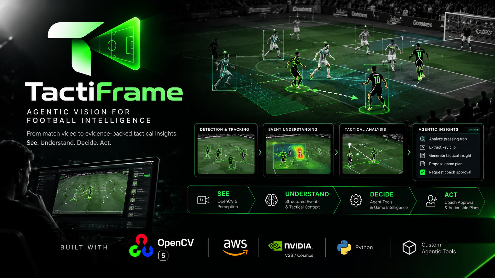
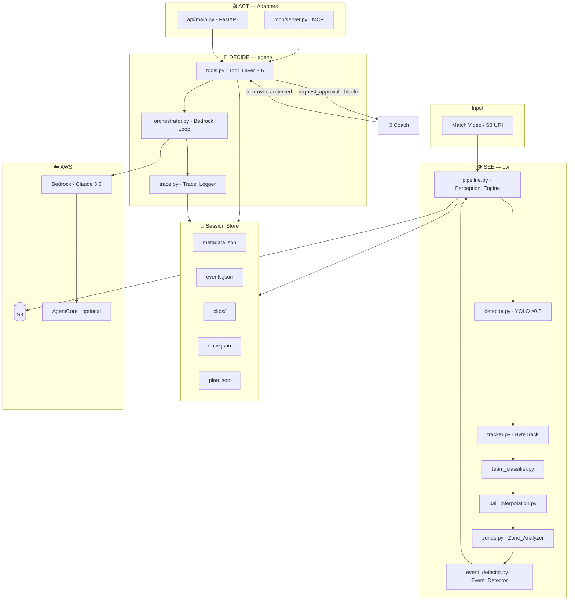

<p align="center">
  
</p>

<p align="center">
  
</p>

<p align="center">
  <a href="https://devpost.com/software/tactiframe"></a>
  
  
  
  
  
</p>

<p align="center">
  <strong>Football match video in → Evidence-backed tactical intelligence out</strong><br/>
  A fully agentic vision pipeline: <code>SEE</code> with OpenCV 5 → <code>UNDERSTAND</code> events → <code>DECIDE</code> via Bedrock → <code>ACT</code> with coach approval
</p>

---

## 🏆 Why TactiFrame?

Most AI football tools are either **static dashboards** or **chatbots over frozen frames**. TactiFrame is neither.

It is a **genuine agentic system**: it watches a match clip, detects what actually happened using real computer vision, forms and revises hypotheses about the opposition's tactics, calls tools to gather evidence, drafts a tactical plan, and then **waits for the coach to approve it** before delivering anything.

Every decision is traceable — you can open `trace.json` and see exactly which detected event caused the agent to change its mind.

---

## 🎯 Competition Criteria Checklist

| Criterion | How TactiFrame addresses it | Evidence |
|---|---|---|
| **Uses OpenCV 5** | YOLO inference + ByteTrack + VideoCapture clip extraction all run through OpenCV 5 | `cv/pipeline.py`, `cv/detector.py` |
| **Agentic behaviour** | Bedrock Converse loop (≤ 10 iterations): hypothesis → tool call → evidence evaluation → refinement | `agent/orchestrator.py` |
| **AWS integration** | S3 for video + evidence clips; Amazon Bedrock for reasoning; optional AgentCore routing | `agent/orchestrator.py`, `cv/pipeline.py` |
| **Real computer vision** | Actual player/ball detection, persistent tracking, zone mapping, event classification — no mocked frames | `cv/` |
| **Vision drives decisions** | `Trace_Logger` records every hypothesis change and the evidence clip that caused it | `agent/trace.py` |
| **Human-in-the-loop** | `request_approval` hard-blocks — zero plans are auto-delivered without explicit coach sign-off | `agent/tools.py` |
| **Reproducible & testable** | 14 property-based tests (Hypothesis), no live AWS credentials required | `tests/` |
| **MCP compatible** | Full MCP server wrapping all 6 tools — plugs into any MCP-compatible agent framework | `mcp/server.py` |

---

## ⚙️ How the Agent Actually Works

This is not a one-shot prompt. The `AgentOrchestrator` runs a **stateful multi-step Bedrock Converse loop**:

```
┌──────────────────────────────────────────────────────────────┐
│                   AGENT REASONING LOOP                       │
│                   (max 10 iterations)                        │
│                                                              │
│  [1] run_perception(video)  ──→  7 events detected          │
│        ↓ hypothesis formed: "opponent active in transition"  │
│                                                              │
│  [2] list_events(session)   ──→  evidence gathered          │
│        ↓ hypothesis updated: "high press + left flank risk"  │
│                                                              │
│  [3] analyze_zone("Z02")    ──→  team_b: 48 frames          │
│        ↓ hypothesis confirmed: "overload on left flank"      │
│                                                              │
│  [4] draft_plan(question)   ──→  plan drafted               │
│        ↓ evidence-first gate enforced ✓                      │
│                                                              │
│  [5] request_approval(plan) ──→  BLOCKS ← coach decision    │
└──────────────────────────────────────────────────────────────┘
```

Every step is recorded in `trace.json` with `hypothesis_before` / `hypothesis_after` fields so judges can verify the **vision-to-decision chain**.

### The Evidence-First Gate

`draft_plan` will **hard-refuse** if `list_events` has not been called first. This is enforced in the single `agent/tools.py` source — both the FastAPI adapter and the MCP server inherit it automatically, with zero duplicated logic.

```python
# agent/tools.py — enforced in one place, inherited everywhere
def draft_plan(session_id: str, question: str) -> dict:
    if not metadata.get("events_reviewed"):
        return {"error": "list_events must be called before draft_plan"}
    # proceed to orchestrator ...
```

---

## 🏗️ Architecture



### Key Design Decisions

| Decision | Rationale |
|---|---|
| **Single `agent/tools.py`** | MCP + FastAPI are thin adapters — zero logic duplication, single source of truth |
| **Bedrock Converse API** | Model-agnostic; swap `BEDROCK_MODEL_ID` to change foundation model with no code change |
| **File-based sessions** | UUID-isolated `data/sessions/{id}/` — fully reproducible, no database setup for judges |
| **AgentCore opt-in** | `AGENTCORE_ENABLED=true` routes tool dispatch through AgentCore; false = local execution |
| **Property-based testing** | Hypothesis verifies 14 correctness properties across arbitrary inputs, not just example cases |

---

## 🔍 Agentic Trace — Live Example

Open `data/sessions/{id}/trace.json` after any run:

```json
{
  "session_id": "3f2a1b9c-...",
  "started_at": "2026-10-10T10:00:00Z",
  "ended_at":   "2026-10-10T10:00:18Z",
  "tool_calls": [
    {
      "step": 1,
      "tool_name": "run_perception",
      "input": { "video_path": "clip.mp4" },
      "output_summary": "Session created. 7 events detected.",
      "hypothesis_before": "",
      "hypothesis_after": "Opponent is active in transition — 7 events in 35 seconds"
    },
    {
      "step": 2,
      "tool_name": "list_events",
      "input": { "session_id": "3f2a1b9c-..." },
      "output_summary": "pass@4.12s, press@8.75s, shot@14.33s, cross@19.01s ...",
      "hypothesis_before": "Opponent active in transition",
      "hypothesis_after": "High press + left-flank overload detected — investigate Z02"
    },
    {
      "step": 3,
      "tool_name": "analyze_zone",
      "input": { "session_id": "3f2a1b9c-...", "zone_id": "Z02" },
      "output_summary": "dominant_team: team_b · occupancy { team_b: 48, team_a: 12 }",
      "hypothesis_before": "Possible left-flank overload",
      "hypothesis_after": "Confirmed: team_b dominates Z02 — trigger press in Z05 to counter"
    },
    {
      "step": 4,
      "tool_name": "draft_plan",
      "output_summary": "Plan drafted. Evidence: evt-002 (press@8.75s), evt-003 (shot@14.33s)"
    }
  ],
  "approval": {
    "decision": "approved",
    "reason": "",
    "timestamp": "2026-10-10T10:01:04Z"
  }
}
```

> **Judge note:** `hypothesis_before` → `hypothesis_after` on every step is the machine-verifiable proof that vision outputs changed agent decisions.

---

## 🚀 Quickstart

```bash
# 1 · Clone
git clone https://github.com/ousssamarahmani/tactiframe.git
cd tactiframe

# 2 · Install
python -m venv .venv
source .venv/bin/activate        # Windows: .venv\Scripts\activate
pip install -r requirements.txt

# 3 · Configure
cp .env.example .env
# Set: S3_BUCKET, BEDROCK_MODEL_ID, AWS_REGION, YOLO_WEIGHTS_PATH

# 4 · Download weights (not in repo — see .gitignore)
mkdir -p models
wget -O models/yolo.pt https://github.com/ultralytics/assets/releases/download/v8.3.0/yolov8n.pt

# 5 · Perception only
python run_pipeline.py --video /path/to/clip.mp4

# 6 · Full agent loop (Bedrock + approval gate)
python run_agent.py --video /path/to/clip.mp4

# 7 · Tests — zero live AWS credentials needed
pytest tests/ -v
```

---

## 🌐 API Reference

```
POST  /analyse              Submit video path or S3 URI → { session_id }
GET   /events/{session_id}  All detected events for a session
GET   /clip/{event_id}      Evidence clip local path + S3 URL
POST  /approve/{session_id} Coach decision { decision, reason }
GET   /session/{session_id} Session metadata + plan status
```

Start the server:
```bash
uvicorn api.main:app --host 0.0.0.0 --port 8000 --reload
```

---

## 🔌 MCP Integration

TactiFrame ships a full **Model Context Protocol** server. Connect any MCP-compatible agent in seconds:

```python
# mcp/server.py — zero duplicated logic
from mcp.server.fastmcp import FastMCP
from agent.tools import run_perception, list_events, get_clip, \
                        analyze_zone, draft_plan, request_approval

mcp = FastMCP("TactiFrame")

@mcp.tool()
def run_perception_tool(video_path: str) -> dict:
    return run_perception(video_path)
# ... same pattern for all 6 tools
```

Transport: `stdio` (default) or `streamable-http` via `MCP_TRANSPORT` env var.

---

## ✅ Correctness — 14 Property-Based Tests

All invariants are verified with [Hypothesis](https://hypothesis.readthedocs.io/) (100 examples each):

| # | Property | What it proves |
|---|---|---|
| 1 | Detection confidence threshold | Only detections ≥ 0.5 conf pass the filter |
| 2 | Zone assignment completeness | Every pitch coordinate maps to exactly one valid zone |
| 3 | Evidence clip boundary clamping | `clip = [max(0, t-2), min(d, t+2)]` for all `t`, `d` |
| 4 | Session path uniqueness | No two sessions ever share a directory path |
| 5 | Event timestamp precision | All timestamps stored as `round(ts, 2)` |
| 6 | Zone occupancy conservation | Sum of occupancy counts = total (track, frame) pairs in window |
| 7 | Dominant team correctness | `dominant_team` is always the team with highest frame count |
| 8 | Evidence-first gate | `draft_plan` without prior `list_events` → always returns `error` |
| 9 | Trace tool-call completeness | `trace.tool_calls` count == Tool_Layer invocation count |
| 10 | Reasoning loop bound | Loop terminates at ≤ 10 iterations regardless of input |
| 11 | Approval status transition | `pending_approval` → `approved` or `revision_required`, never stuck |
| 12 | Rejection reason round-trip | Coach reason returned byte-for-byte, including empty string |
| 13 | MCP delegation identity | MCP result == direct tool call result for all 6 tools |
| 14 | Draft plan evidence linkage | Every `draft_plan` `event_ids` ⊆ prior `list_events` event IDs |

```bash
pytest tests/ -v --tb=short   # no AWS credentials needed
```

---

## 📁 Repository Structure

```
tactiframe/
├── cv/
│   ├── detector.py          # YOLO detection (confidence ≥ 0.5)
│   ├── tracker.py           # ByteTrack multi-object tracking
│   ├── team_classifier.py   # Jersey-colour team assignment
│   ├── ball_interpolation.py
│   ├── zones.py             # Zone_Analyzer (configurable grid, 6–64 zones)
│   ├── event_detector.py    # pass / shot / cross / press / set_piece
│   └── pipeline.py          # Perception_Engine — full cv/ orchestration
│
├── agent/
│   ├── tools.py             # Tool_Layer — single source of truth (6 tools)
│   ├── orchestrator.py      # Agent_Orchestrator — Bedrock Converse loop
│   ├── prompts.py           # System prompt for Bedrock
│   └── trace.py             # Trace_Logger — hypothesis + tool call journal
│
├── api/
│   ├── main.py              # FastAPI app (5 endpoints)
│   └── schemas.py           # Pydantic v2 models
│
├── mcp/
│   └── server.py            # MCP_Server — FastMCP wrapper, no logic duplication
│
├── tests/
│   ├── conftest.py          # Shared fixtures (synthetic video, mock S3, mock Bedrock)
│   ├── test_agent_trace.py  # Required trace tests (Req 10)
│   ├── test_cv_properties.py
│   ├── test_tools_properties.py
│   ├── test_orchestrator.py
│   ├── test_approval.py
│   └── test_api.py
│
├── aws/
│   ├── apprunner.yaml       # App Runner service definition
│   └── lambda_handler.py    # Mangum shim for Lambda container
│
├── docs/
│   ├── ARCHITECTURE.md
│   ├── HACKATHON.md
│   ├── EVAL.md
│   └── assets/
│       ├── logo.png
│       └── banner.png
│
├── config.py                # All constants — env-var overridable
├── run_pipeline.py          # CLI: perception only
├── run_agent.py             # CLI: full agent loop
├── requirements.txt         # Pinned dependencies
├── Dockerfile               # Multi-stage container image
└── .env.example             # Environment template
```

---

## 🚫 Non-Goals

These are explicitly out of scope — by design, not by oversight:

- **Multi-camera production analytics** — single clip per session
- **Chatbot-only Q&A on static frames** — real CV on real video only
- **Real-time live-stream processing** — pre-recorded footage
- **Full 90-minute match processing** — optimised for analysis clips
- **Player biometric identification** — bounding box + team colour only
- **NVIDIA VSS / Cosmos** — P2 stretch goal, only after P0 verified

---

## 📖 Documentation

| Doc | Description |
|---|---|
| [docs/ARCHITECTURE.md](docs/ARCHITECTURE.md) | Full component map, data flow, design decisions |
| [docs/HACKATHON.md](docs/HACKATHON.md) | Competition context, P0/P1/P2 priority table, non-goals |
| [docs/EVAL.md](docs/EVAL.md) | Evaluation criteria, known limitations, exact reproduction steps |

---

## 📄 License

[MIT](LICENSE) © 2026 Marouan Balha

---

<p align="center">
  Built for the <strong>OpenCV AI Competition 2026</strong> · Agentic Vision track · Powered by AWS<br/>
  <a href="https://github.com/ousssamarahmani/tactiframe">github.com/ousssamarahmani/tactiframe</a>
</p>
