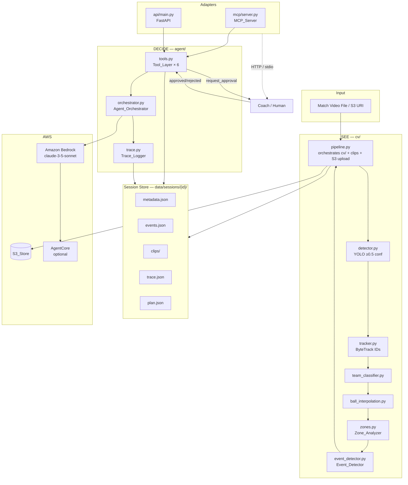

<p align="center">
  
</p>

# TactiFrame

> Agentic Vision system that converts football match video into evidence-backed tactical intelligence — OpenCV AI Competition 2026 entry (Agentic Vision track with AWS).

---

## Architecture



---

## Quickstart

```bash
# 1. Clone and install
git clone https://github.com/<your-org>/tactiframe.git
cd tactiframe
python -m venv .venv && source .venv/bin/activate
pip install -r requirements.txt

# 2. Configure
cp .env.example .env
# Edit .env: S3_BUCKET, BEDROCK_MODEL_ID, AWS_REGION, YOLO_WEIGHTS_PATH

# 3. Download model weights (not committed — see docs/EVAL.md)
mkdir -p models
wget -O models/yolo.pt https://github.com/ultralytics/assets/releases/download/v8.3.0/yolov8n.pt

# 4. Run the perception pipeline
python run_pipeline.py --video /path/to/clip.mp4

# 5. Run the full agent loop
python run_agent.py --video /path/to/clip.mp4

# 6. Run all tests (no live AWS credentials required)
pytest tests/ -v
```

---

## Demo Flow

```
POST /analyse  {"video_path": "clip.mp4"}
  → session_id: "3f2a1b9c-..."

GET  /events/3f2a1b9c-...
  → 7 events: pass@4.12s, press@8.75s, shot@14.33s, ...

# Agent loop runs automatically:
#   Iteration 1: run_perception
#   Iteration 2: list_events (evidence gathered)
#   Iteration 3: analyze_zone Z05
#   Iteration 4: draft_plan  ← evidence-first gate enforced

POST /approve/3f2a1b9c-...  {"decision": "approved"}
  → Plan delivered to coaching staff
```

---

## How This Meets Agentic Vision

TactiFrame satisfies the Agentic Vision track criteria through four properties:

1. **Real computer vision** — OpenCV 5 + YOLO detects players and ball; ByteTrack assigns persistent IDs; Zone_Analyzer maps positions to configurable pitch zones.

2. **Autonomous multi-step reasoning** — The Agent_Orchestrator drives a Bedrock Converse loop (up to 10 iterations). It forms a hypothesis, calls tools to gather evidence, updates its hypothesis based on vision outputs, and refines the plan — not a static one-shot prompt.

3. **Vision-to-decision linkage** — The Trace_Logger records every reasoning step and the evidence clip that triggered each hypothesis change. Judges can verify that vision outputs directly changed agent decisions.

4. **Human-in-the-loop approval** — No tactical plan reaches the coaching staff without explicit approval via the Approval_Gate. The `request_approval` tool blocks until the coach responds.

### Trace Example

```json
{
  "session_id": "3f2a1b9c-...",
  "tool_calls": [
    {
      "step": 1,
      "tool_name": "run_perception",
      "input": {"video_path": "clip.mp4"},
      "output_summary": "7 events detected, session 3f2a1b9c-...",
      "hypothesis_before": "",
      "hypothesis_after": "Opponent is active in transition — 7 events in 35s"
    },
    {
      "step": 2,
      "tool_name": "list_events",
      "input": {"session_id": "3f2a1b9c-..."},
      "output_summary": "pass@4.12s, press@8.75s, shot@14.33s ...",
      "hypothesis_before": "Opponent is active in transition",
      "hypothesis_after": "Opponent pressing high and shooting from Z05 — potential overload on left flank"
    },
    {
      "step": 3,
      "tool_name": "analyze_zone",
      "input": {"session_id": "3f2a1b9c-...", "zone_id": "Z02"},
      "output_summary": "dominant_team: team_b, occupancy: {team_b: 48, team_a: 12}",
      "hypothesis_before": "Opponent overloading left flank",
      "hypothesis_after": "Confirmed: team_b dominates Z02 (left flank) — recommend pressing trigger in Z05"
    },
    {
      "step": 4,
      "tool_name": "draft_plan",
      "input": {"session_id": "3f2a1b9c-...", "question": "How should we defend against this opposition?"},
      "output_summary": "Plan drafted, referencing events evt-002 and evt-003",
      "hypothesis_before": "Confirmed overload on left flank",
      "hypothesis_after": "Plan complete"
    }
  ],
  "approval": {
    "decision": "approved",
    "reason": "",
    "timestamp": "2026-09-22T10:15:42Z"
  }
}
```

---

## Non-Goals

- **Multi-camera production analytics** — single video clip per session
- **Chatbot-only Q&A** — TactiFrame runs real CV on real video, not static frame Q&A
- **Real-time streaming** — pre-recorded footage only
- **Full 90-minute match processing** — optimised for short analysis clips
- **Player biometric identification** — tracking by bounding box + team colour only

See [docs/HACKATHON.md](docs/HACKATHON.md) for the full priority table and non-goals.

---

## Repository Structure

```
tactiframe/
├── cv/                    # Perception layer (SEE phase)
├── agent/                 # Decision layer (DECIDE + ACT phases)
├── api/                   # FastAPI HTTP adapter
├── mcp/                   # MCP server adapter
├── tests/                 # Test suite (pytest + Hypothesis)
├── docs/                  # Documentation
├── aws/                   # Deployment configuration
├── config.py              # Central configuration
├── run_pipeline.py        # CLI entry point — perception only
├── run_agent.py           # CLI entry point — full agent loop
├── requirements.txt       # Pinned dependencies
└── Dockerfile             # Container image
```

---

## Docs

- [docs/ARCHITECTURE.md](docs/ARCHITECTURE.md) — component descriptions and data flow
- [docs/HACKATHON.md](docs/HACKATHON.md) — competition context, priority table, non-goals
- [docs/EVAL.md](docs/EVAL.md) — evaluation criteria, known limitations, reproduction steps

---

## License

[MIT](LICENSE)
