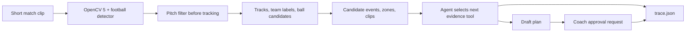

# TactiFrame

<p align="center"></p>
<p align="center"></p>
<p align="center"><strong>See the match. Inspect the evidence. Prepare the coach.</strong></p>

<p align="center">
  <a href="docs/EVAL.md"></a>
  <a href="docs/AGENT_LOOP.md"></a>
  <a href="docs/HACKATHON.md"></a>
</p>

> **The banner is concept artwork.** It depicts planned AWS and NVIDIA capabilities. The status table below says what this repository implements today.

[Why TactiFrame](#why-tactiframe) · [How it works](#how-it-works) · [Build status](#build-status) · [Run locally](#run-locally) · [Agentic Vision proof](#agentic-vision-proof) · [Roadmap](#roadmap)

---

## Why TactiFrame

Opposition analysis needs a link between a claim and the match moment behind it. TactiFrame processes a short football clip, groups **candidate** visual events by image zone, opens evidence clips, and drafts a question for a coach to review. The coach decides whether the proposed analysis should be used.

TactiFrame targets the **OpenCV AI Competition 2026 — Agentic Vision with AWS** track. Video results must change the runtime's next tool call, plan, action, or approval request. Using an AI assistant to write code does not satisfy that requirement.

| See | Understand | Decide | Act with a coach |
|---|---|---|---|
| OpenCV 5 video processing; football detection and tracking | Candidate events, image zones, evidence clips | Agent tools select the next evidence check from event results | Draft a provisional plan and request explicit approval |

## How it works



The offline worker builds on [TactiScout-CV](https://github.com/Marouan-balha/TactiScout-CV). Optional clip-specific manual polygons exclude sideline detections before ByteTrack. Current events are `zone_density` and `zone_contest` candidates in a 3×3 **image-relative** grid. They are not verified passes, turnovers, possession, or calibrated pitch locations. See the [event contract](docs/EVENT_CONTRACT.md) and [architecture](docs/ARCHITECTURE.md).

## Build status

| Requirement | Repository today | Status |
|---|---|---|
| OpenCV 5 perception | `run_pipeline.py` writes tracks, sampled team labels, ball candidates, annotated video, and versioned metadata | **Local run verified** |
| Pitch-aware filtering | Class, size, turf, and optional manual polygon filters run before tracking | **Local A/B verified** |
| Events and evidence | `detect_events.py` writes two candidate event types, image zones, and playable clips | **Implemented; accuracy unverified** |
| Agentic tool sequence | Six tools in `agent/tools.py`; the orchestrator changes its next call from event results and records `trace.json` | **Local run verified** |
| Human approval | `plan.json` stays pending until a coach explicitly records approved or rejected | **Scripted path; no live coach decision yet** |
| AWS and API | S3/Bedrock integration and FastAPI endpoints | **Not implemented** |
| Public demo assets | Footage and model terms suitable for a public submission | **Not ready** |
| MCP / NVIDIA | Optional adapters and VSS/Cosmos | **Later** |

**Measured local check:** On the same 2½-minute clip, a manual polygon reduced final track observations from 13,206 to 11,760 and removed a known false sideline event near 125 seconds. The cleaned run produced 35 candidate events and clips. The earlier event mix made the agent call `get_clip` next; the polygon run made it call `analyze_zone` next. Both traces end at a pending approval request. These are local A/B observations, not labeled accuracy scores or a completed AWS demo. See [evaluation](docs/EVAL.md), [field polygon review](docs/FIELD_POLYGON.md), and [agent trace review](docs/AGENT_LOOP.md).

## Run locally

**Prerequisites:** Python 3.11 or 3.13, an OpenCV 5 compatible environment, a short football clip, and football-specific YOLO weights. The model must use class IDs `ball=0`, `goalkeeper=1`, `player=2`, `referee=3`; generic COCO weights use different IDs. Video, weights, and run outputs stay under Git-ignored `data/` and `models/`.

```powershell
git clone https://github.com/ousssamarahmani/Tactiframe.git
cd Tactiframe
py -3.11 -m venv .venv
.\.venv\Scripts\python -m pip install -r requirements.txt
.\.venv\Scripts\python run_agent.py `
  --video data\input\match.mp4 `
  --model models\football.pt `
  --output-dir data\sessions\demo-run
```

Add `--field-polygons data\input\match-field-polygons.json` for a calibration made for **that exact clip**; see the [calibration guide](docs/FIELD_POLYGON.md). For an existing completed session, use `.\.venv\Scripts\python run_agent.py --run-dir data\sessions\demo-run`.

The session contains `run.json`, `tracks.json`, `tracks_with_teams.json`, `ball_observations.json`, `tracked.mp4`, `events.json`, `clips/`, `trace.json`, and `plan.json`. `run.json` records actual library versions, model hash, and filter settings.

After a coach reviews the plan and source clip, record their actual decision:

```powershell
.\.venv\Scripts\python approve_plan.py --run-dir data\sessions\demo-run --decision approved --coach "Coach Name"
```

Use `--decision rejected` when appropriate. The demo does not approve itself. Run tests with `.\.venv\Scripts\python -m unittest discover tests -q` (24 passed in the last checked environment).

## Agentic Vision proof

The qualification check is visible in `trace.json`: `run_perception` → `list_events` → a recorded choice → `get_clip` **or** `analyze_zone` → `draft_plan` → `request_approval`. `draft_plan` refuses to run until `list_events` was called in that session.

Two real local runs took different next steps because their OpenCV-derived candidate event counts differed. The [trace walkthrough](docs/AGENT_LOOP.md) records both sequences. This establishes a local perception → decision → approval-request loop. AWS integration, reviewed tactical evidence, and a publicly usable demo clip remain submission work.

## Roadmap

1. **P0:** Review event quality on the chosen clip; secure public demo footage and document model provenance.
2. **P0:** Connect the tools to meaningful AWS storage and/or Bedrock use, add the FastAPI demo path, and verify the full workflow.
3. **P0:** Record a real coach decision, complete end-to-end evaluation, and prepare evidence before the 26 October 2026 deadline.
4. **P1:** MCP wrapper around the same six tools and light judge-facing polish.
5. **P2:** NVIDIA VSS/Cosmos only after P0 works. React or Next.js is not required for qualification.

The [hackathon checklist](docs/HACKATHON.md) is a target specification; the table above records current implementation.

## Repository map

| Path | Purpose |
|---|---|
| `run_pipeline.py`, `cv/` | OpenCV observation, pitch filtering, tracking, and zones |
| `detect_events.py`, `cv/event_detector.py` | Candidate events and evidence clips |
| `agent/`, `run_agent.py`, `approve_plan.py` | Six-tool local loop, trace, and coach decision |
| `tests/` | Perception, filtering, event, gate, and tool-order checks |
| `docs/EVAL.md` | Measured runs and limitations |
| `docs/ASSETS.md` | Footage and model provenance |

## Limits, assets, and license

Track IDs fragment across camera motion; ball candidates include false positives; team colors and image zones lack manual validation. The current match recording and all derived clips are **local simulation and education material only**. They are not public submission footage. See [asset provenance](docs/ASSETS.md) before publishing media.

The repository has an [MIT license](LICENSE) for its code. Model weights, datasets, match footage, and artwork may have separate terms; current checkpoint use is described in [docs/ASSETS.md](docs/ASSETS.md). Platform names in the banner identify intended integrations, not sponsorship or endorsement.
