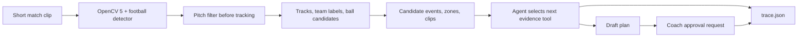

# TactiFrame

<p align="center"></p>
<p align="center"></p>
<p align="center"><strong>See the match. Inspect the evidence. Prepare the coach.</strong></p>

<p align="center">
  <a href="docs/EVAL.md"></a>
  <a href="docs/AGENT_LOOP.md"></a>
  <a href="docs/AWS_SETUP.md"></a>
  <a href="docs/API.md"></a>
</p>

> **The banner is concept artwork.** It depicts planned AWS and NVIDIA capabilities. The status table below says what this repository implements today.

[Why TactiFrame](#why-tactiframe) · [How it works](#how-it-works) · [Build status](#build-status) · [Run locally](#run-locally) · [Review API](docs/API.md) · [Demo](docs/DEMO.md) · [Roadmap](#roadmap)

---

## Why TactiFrame

Opposition analysis needs a link between a claim and the match moment behind it. TactiFrame processes a short football clip, groups **candidate** visual events by image zone, opens evidence clips, and drafts a question for a coach to review. The coach decides whether the proposed analysis should be used.

TactiFrame is an evidence-backed football-analysis MVP. Video results change the runtime's next tool call, plan, action, or approval request; a coach remains responsible for accepting or rejecting a draft.

| See | Understand | Decide | Act with a coach |
|---|---|---|---|
| OpenCV 5 video processing; football detection and tracking | Candidate events, image zones, evidence clips | Agent tools select the next evidence check from event results | Draft a provisional plan and request explicit approval |

## How it works



The offline worker builds on [TactiScout-CV](https://github.com/Marouan-balha/TactiScout-CV). Optional clip-specific manual polygons exclude sideline detections before ByteTrack. Current events are `zone_density` and `zone_contest` candidates in a 3×3 **image-relative** grid. They are not verified passes, turnovers, possession, or calibrated pitch locations. See the [event contract](docs/EVENT_CONTRACT.md) and [architecture](docs/ARCHITECTURE.md).

## Build status

| Requirement | Repository today | Status |
|---|---|---|
| OpenCV 5 perception | `run_pipeline.py` writes tracks, sampled team labels, ball candidates, annotated video, and versioned metadata | **Local run verified** |
| Pitch-aware filtering | Class, size, turf, and optional manual polygon filters run before tracking | **Local A/B verified** |
| Events and evidence | `detect_events.py` writes two candidate event types, image zones, and playable clips | **Implemented; accuracy unverified** |
| Agentic tool sequence | Six tools in `agent/tools.py`; the orchestrator changes its next call from event results and records `trace.json` | **Local run verified** |
| Human approval | `plan.json` stays pending until a coach explicitly records approved or rejected | **Scripted path; no live coach decision yet** |
| AWS evidence adapters | Private S3 sync and a Nova Pro evidence-bound proposal adapter | **Real-account session validated** |
| FastAPI review API | Session, events, trace, plan, and validated approval endpoints | **Implemented and tested** |
| Public demo assets | Footage and model terms suitable for a public submission | **Not ready** |
| MCP / NVIDIA | Optional adapters and VSS/Cosmos | **Later** |

**Measured local check:** On the same 2½-minute clip, a manual polygon reduced final track observations from 13,206 to 11,760 and removed a known false sideline event near 125 seconds. The cleaned run produced 35 candidate events and clips. The earlier event mix made the agent call `get_clip` next; the polygon run made it call `analyze_zone` next. The validated AWS run uploaded 35 evidence clips plus session JSON artifacts to private S3 and used Nova Pro to draft a pending coach-review plan. These are local A/B observations, not labeled tactical accuracy scores. See [evaluation](docs/EVAL.md), [field polygon review](docs/FIELD_POLYGON.md), and [agent trace review](docs/AGENT_LOOP.md).

## Run locally

**Prerequisites:** Python 3.11 or 3.13, an OpenCV 5 compatible environment, a short football clip, and football-specific YOLO weights. The model must use class IDs `ball=0`, `goalkeeper=1`, `player=2`, `referee=3`; generic COCO weights use different IDs. Video, weights, and run outputs stay under Git-ignored `data/` and `models/`.

```powershell
git clone https://github.com/ousssamarahmani/Tactiframe.git
cd Tactiframe
py -3.11 -m venv .venv
.\.venv\Scripts\python -m pip install -r requirements.txt
.\.venv\Scripts\python run_agent.py `
  --video data\input\match.mp4 `
  --model models\football.pt `
  --output-dir data\sessions\demo-run
```

Add `--field-polygons data\input\match-field-polygons.json` for a calibration made for **that exact clip**; see the [calibration guide](docs/FIELD_POLYGON.md). For an existing completed session, use `.\.venv\Scripts\python run_agent.py --run-dir data\sessions\demo-run`.

The session contains `run.json`, `tracks.json`, `tracks_with_teams.json`, `ball_observations.json`, `tracked.mp4`, `events.json`, `clips/`, `trace.json`, and `plan.json`. `run.json` records actual library versions, model hash, and filter settings.

After a coach reviews the plan and source clip, record their actual decision:

```powershell
.\.venv\Scripts\python approve_plan.py --run-dir data\sessions\demo-run --decision approved --coach "Coach Name"
```

Use `--decision rejected` when appropriate. The demo does not approve itself. Run tests with `.\.venv\Scripts\python -m unittest discover tests -q` (44 focused tests passed in the last checked environment).

### Review through HTTP

Start the local review API with `.\.venv\Scripts\uvicorn api.main:app --host 127.0.0.1 --port 8000`. It exposes session metadata, candidate events, trace, plan, and the same explicit coach-approval gate used by the CLI. See the [API guide](docs/API.md).

### Repeatable coach-review demo

For one complete session → evidence → proposal → named-decision path, run [demo.ps1](demo.ps1) with a completed session, a coach name, and an explicit `approved` or `rejected` decision. See the [demo guide](docs/DEMO.md).

## Agentic Vision proof

The proof is visible in `trace.json`: `run_perception` → `list_events` → a recorded choice → `get_clip` **or** `analyze_zone` → `draft_plan` → `request_approval`. `draft_plan` refuses to run until `list_events` was called in that session. A successful Nova Pro proposal is recorded only after OpenCV selects the event and evidence clip.

## Roadmap

TactiFrame is evolving into an **Agentic Vision engine for football intelligence**. The [current task list](docs/PRODUCT_VISION_AND_BACKLOG.md#current-task-list--source-of-truth) and full product position, deployment boundaries, testing strategy, and implementation backlog are in [Product Vision and Backlog](docs/PRODUCT_VISION_AND_BACKLOG.md).

The immediate ordered backlog is:

1. Complete the controlled tracking A/B run and accept or reject the single changed setting from evidence.
2. Generate tested heatmap, zone-matrix, and team-shape evidence artifacts from session tracks.
3. Extend the session API for those artifacts.
4. Build evidence-bound Agent Vision Chat using the existing tool and trace contract.
5. Split the core roles into Video Analyst, Vision Agent, and Tactical Analyst simulations before deploying them independently.
6. Deploy the CV worker and lead agent in the measured AWS order described in the product backlog.

The future coach-facing layer is described in [TactiFrame Workspace](docs/PRODUCT_WORKSPACE.md). It must reuse the evidence contract rather than bypass it.

## Repository map

| Path | Purpose |
|---|---|
| `run_pipeline.py`, `cv/` | OpenCV observation, pitch filtering, tracking, and zones |
| `detect_events.py`, `cv/event_detector.py` | Candidate events and evidence clips |
| `agent/`, `run_agent.py`, `approve_plan.py` | Six-tool local loop, trace, and coach decision |
| `api/`, `docs/API.md` | Local review API and HTTP approval workflow |
| `demo.ps1`, `docs/DEMO.md` | Repeatable agent → review API → explicit coach-decision demonstration |
| `tests/` | Perception, filtering, event, gate, tool-order, and evaluation-harness checks |
| `docs/EVAL.md` | Measured runs and limitations |
| `evaluate_session.py`, `validate_ball_candidates.py`, `diagnose_tracks.py`, `generate_evidence_artifacts.py`, `run_tracking_ab.ps1` | Per-session metrics, candidate heatmaps/matrices/shapes, CV diagnostics, and controlled A/B runs |
| `docs/CV_BASELINE.md` | Frozen pitch-aware CV reference and acceptance checks |
| `docs/AWS_SETUP.md` | Private S3 and Bedrock setup, runtime behavior, and validation |
| `docs/ASSETS.md` | Footage and model provenance |
| `docs/PRODUCT_VISION_AND_BACKLOG.md` | Product vision, agent boundaries, production roadmap, simulation plan, and pilot path |

## Limits, assets, and license

Track IDs fragment across camera motion; ball candidates include false positives; team colors and image zones lack manual validation. The current match recording and all derived clips are **local simulation and education material only**. They are not public submission footage. See [asset provenance](docs/ASSETS.md) before publishing media.

The repository has an [MIT license](LICENSE) for its code. Model weights, datasets, match footage, and artwork may have separate terms; current checkpoint use is described in [docs/ASSETS.md](docs/ASSETS.md). Platform names in the banner identify intended integrations, not sponsorship or endorsement.
