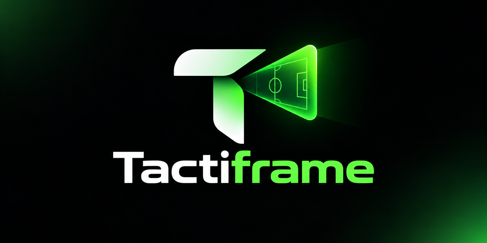

# TactiFrame

<p align="center">
  
</p>

<p align="center">
  
</p>

> The banner is concept artwork. The current implementation status is described below; AWS and NVIDIA integrations shown in the artwork are not shipped yet.

Agentic Vision for football opposition analysis. The intended pipeline is SEE (OpenCV 5) → UNDERSTAND (events) → DECIDE (agent tools) → ACT (coach approval).

## Current status

The offline **observation baseline has completed a full-duration technical run on a 4-minute-15-second match segment**. `run_pipeline.py` adapts the [TactiScout-CV](https://github.com/Marouan-balha/TactiScout-CV) observation worker and writes player tracks, sampled team labels, ball observations, an annotated video, and run metadata. The first full run used upstream BoT-SORT; the current worker uses Supervision ByteTrack so class, confidence, size, and visible-turf filters run before tracking. The user-designated match recording and its derived outputs are for local simulation and education only. See [docs/ASSETS.md](docs/ASSETS.md) for source hashes, model provenance, and the remaining public-footage gap.

An initial **candidate** event layer now writes image-relative zones and evidence clips from the observation run. It has two visual event types and has not been manually validated. The six local agent tools, a vision-dependent tool sequence, trace, and a scripted coach-approval request are implemented. FastAPI, AWS integration, and MCP are still unimplemented. See [docs/EVENT_CONTRACT.md](docs/EVENT_CONTRACT.md) and [docs/AGENT_LOOP.md](docs/AGENT_LOOP.md). Do not treat [docs/ARCHITECTURE.md](docs/ARCHITECTURE.md) as an implementation inventory.

## Observation baseline

Use Python 3.11 or 3.13 and install `requirements.txt` in a virtual environment. Put a rights-cleared 3–5 minute tactical, sideline, or broadcast match clip under `data/`. Keep the same clip for the observation and later demo runs. The clip and model weights are not committed.

The worker needs football-specific YOLO weights with class IDs:

| ID | Class |
|---:|---|
| 0 | ball |
| 1 | goalkeeper |
| 2 | player |
| 3 | referee |

A generic COCO YOLO model is not a substitute: its IDs have different meanings. The Step 1 checkpoint is the published [YOLO11m football detector](https://huggingface.co/martinjolif/yolo-football-player-detection), stored locally at `models/yolo-football-player-detection.pt` (AGPL-3.0, not committed). It has the required class order. Its [CC BY 4.0 training dataset](https://huggingface.co/datasets/martinjolif/football-player-detection) contains labeled images; those images are training input, not the match video. Local fine-tuning on this machine has not produced a usable checkpoint. Record the exact model source and license when preparing the submission.

```powershell
py -3.11 -m venv .venv
.\.venv\Scripts\python -m pip install -r requirements.txt
.\.venv\Scripts\python run_pipeline.py --video data\your-match-clip.mp4 --model models\yolo-football-player-detection.pt --device cpu
```

By default, each run creates `data/sessions/<timestamp>-<id>/`:

```text
run.json                 run status, input/model checksums, versions, counts
tracks.json              player and goalkeeper detections with track IDs
tracks_with_teams.json   tracks plus sampled jersey-color team labels
ball_observations.json   observed ball positions
tracked.mp4              annotated inspection video
```

`run.json` remains marked `observations-only`. Team calibration can be unavailable; in that case tracks receive `unknown` team labels. No tactical event or verified evidence claim follows from this baseline.

The current worker uses separate `--player-conf` (default 0.30) and `--ball-conf` (default 0.15), `--imgsz` (default 960), `--iou` (default 0.5), and a visible-green-turf check on player feet or the ball center. `--no-pitch-mask` disables the turf check for non-green surfaces. This mask follows visible turf in the camera frame; it is not a calibrated pitch polygon. `run.json` records these settings, filter counts, checkpoint architecture and class names, and OpenCV, Ultralytics, and Torch versions. Ball detections remain unverified candidates; a pitch marking in the local clip has been mistaken for the ball, so interpolation is not yet part of the run output.

### Local technical run, 11 October 2026

The supplied 1080p/30 fps clip (`data/input/video-project-3.mp4`, 7,661 frames) was sampled across its full duration to 720p/5 fps (1,277 frames) with `prepare_clip.py`. The prepared video and its source-checksum manifest are under `data/input/` and ignored by Git. This is a local simulation run; neither its footage nor its visual derivatives are public submission assets. The run used the smaller [uisikdag football checkpoint](https://huggingface.co/uisikdag/yolo-v8-football-players-detection), also ignored by Git; its model card does not clearly identify a license, so this checkpoint is currently a local validation asset. The [YOLO11m checkpoint](https://huggingface.co/martinjolif/yolo-football-player-detection) above has a stated AGPL-3.0 license but ran more slowly on this CPU.

`data/sessions/match-20261011-5fps/` contains `run.json`, `tracks.json`, `tracks_with_teams.json`, `ball_observations.json`, and `tracked.mp4`. The run completed in 453 seconds with 20,005 track observations, 220 final track IDs, 55 ball observations, and provisional team votes for 141 IDs. The annotated video opens and contains all 1,277 frames. IDs fragment across camera motion and cuts, the model sometimes detects sideline people, and ball coverage is sparse (55/1,277 frames). These observations need quality work before events can rely on player continuity or ball possession.

### Filtered local technical run, 11 October 2026

`data/sessions/match-20261011-filtered-960/` used the same full-duration working copy and checkpoint with separate class thresholds, a visible-turf check before ByteTrack, and `imgsz=960`. It completed in 380 seconds and wrote the same five output files; the annotated video opens with 1,277 frames. It produced 22,640 track observations and 179 final IDs. The filter rejected 1,021 detections outside the visible turf and 4,272 below the player threshold. Thirty-second windows still contain 38–55 IDs, above a reliable 11v11 range. The 507 ball candidates include pitch-marking false positives, so their higher count must not be read as better ball tracking. This run is for local evaluation only.

Video review found that this filtered run reused one ID for multiple players in some frames. The corrected merge logic enforces a unique `(frame, track_id)` pair. A full rerun at `data/sessions/match-20261011-safe-merge/` produced 1,277 annotated frames, 22,640 player observations, 174 final IDs, and **zero duplicate frame/ID pairs**. ID turnover and ball false positives remain. Use the three 30-second clips and labeling protocol in [docs/VIDEO_QA.md](docs/VIDEO_QA.md) for the next quality pass; these clips remain local simulation material.

The latest local rerun is `data/sessions/match-20261011-right-boundary/`. A detected right goal line now rejects people standing on green runoff turf outside the field. The 4-minute-15-second run produced 1,277 annotated frames, 21,578 player observations, 171 final IDs, and zero duplicate frame/ID pairs. Its filter rejected 2,841 candidate boxes beyond that line. The reported outside boxes in the right corner are absent in a reviewed frame while the on-pitch goalkeeper remains. The line check only activates when a long right-side boundary is visible; it does not establish full pitch calibration. The ball candidates are unchanged and remain unverified.

A focused manual field-polygon option now gates detections before ByteTrack (`--field-polygons`). On the same 2½-minute local segment, a clip-specific keyframe calibration removed the right-side staff boxes and the false `r0c2` density event at roughly 125 seconds. It produced 11,760 track observations, 87 final IDs, and 35 candidate events. The prior run had 13,206 observations, 96 IDs, and 38 candidates. A box-position comparison matched 11,744 of 11,745 previously retained inside-polygon observations, while 1,461 outside-polygon track observations were absent. These are A/B diagnostics against a manual boundary, not ground-truth accuracy scores. See [docs/FIELD_POLYGON.md](docs/FIELD_POLYGON.md) and [docs/VIDEO_QA.md](docs/VIDEO_QA.md).

Run `python detect_events.py --run-dir data\sessions\match-20261011-right-boundary` to derive candidate `events.json` and event clips from that session. The first local pass yielded 41 candidates (31 `zone_density`, 10 `zone_contest`), each with a clip. These are evidence pointers for review, not validated football actions. The local recording and derived clips must not be used as public submission media.

## Next milestones

1. Obtain footage and model weights cleared for public submission; improve track continuity and ball coverage where event logic needs them.
2. Review candidate events and clips against the source footage; measure false positives and refine the visual event rules.
3. Validate the local agent trace and coach-approval path with reviewed evidence; keep candidate claims provisional.
4. Add AWS integration, FastAPI, and an end-to-end submission demo.

React and Next.js are not needed for the submission path.
