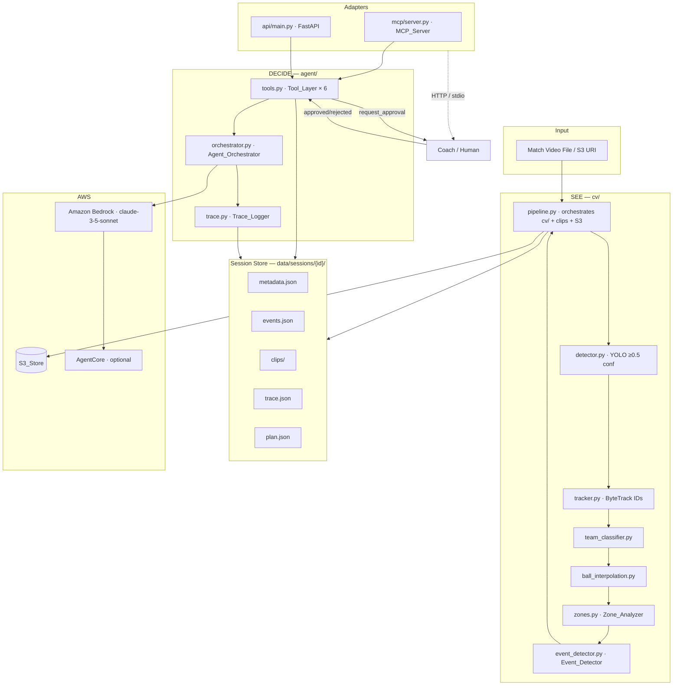

<p align="center">
  
</p>

<p align="center">
  
</p>

<p align="center">
  
  
  
  
  
  
</p>

---

## What is TactiFrame?


TactiFrame is a hackathon entry for the **OpenCV AI Competition 2026 — Agentic Vision track (AWS)**.

It watches a football (soccer) match clip and autonomously:

1. **Detects** players and the ball with YOLO + tracks them with ByteTrack
2. **Maps** every player to a pitch zone and **detects** tactical events (pass, shot, press, cross, set piece)
3. **Extracts** short evidence clips for each event and uploads them to S3
4. **Reasons** about the footage via an Amazon Bedrock agent loop — forming hypotheses, calling tools, and refining a tactical plan
5. **Blocks** until the coach explicitly approves or rejects the plan — no automated recommendation is delivered without human sign-off

The full reasoning trace (tool calls, hypothesis changes, evidence links) is serialised to JSON so judges can verify that vision outputs directly changed agent decisions.

---

## Architecture



---

## Repository Structure

```
tactiframe/
├── cv/                    # SEE phase — OpenCV 5, YOLO, ByteTrack, Zone_Analyzer, Event_Detector
├── agent/                 # DECIDE/ACT — Tool_Layer, Agent_Orchestrator, Trace_Logger
├── api/                   # FastAPI HTTP adapter (5 endpoints)
├── mcp/                   # MCP server adapter (6 tools, no duplicated logic)
├── tests/                 # pytest + Hypothesis property-based tests
├── docs/                  # ARCHITECTURE.md, HACKATHON.md, EVAL.md, assets/
├── aws/                   # App Runner + Lambda container deployment config
├── config.py              # All tuneable constants (env-var overridable)
├── run_pipeline.py        # CLI — perception only
├── run_agent.py           # CLI — full agent loop
├── requirements.txt       # Pinned dependencies
└── Dockerfile             # Multi-stage container image
```

---

## Quickstart

```bash
# 1. Clone and install
git clone https://github.com/ousssamarahmani/tactiframe.git
cd tactiframe
python -m venv .venv && source .venv/bin/activate   # Windows: .venv\Scripts\activate
pip install -r requirements.txt

# 2. Configure
cp .env.example .env
# Edit .env: S3_BUCKET, BEDROCK_MODEL_ID, AWS_REGION, YOLO_WEIGHTS_PATH

# 3. Download model weights (not committed to git)
mkdir -p models
wget -O models/yolo.pt https://github.com/ultralytics/assets/releases/download/v8.3.0/yolov8n.pt

# 4. Run perception pipeline
python run_pipeline.py --video /path/to/clip.mp4

# 5. Run full agent loop
python run_agent.py --video /path/to/clip.mp4

# 6. Run all tests (no live AWS credentials required)
pytest tests/ -v
```

---

## Demo Flow

```
POST /analyse  { "video_path": "clip.mp4" }
  → { "session_id": "3f2a1b9c-..." }

GET  /events/3f2a1b9c-...
  → 7 events: pass@4.12s · press@8.75s · shot@14.33s · cross@19.01s · ...

# Agent loop fires automatically:
#   step 1: run_perception  → 7 events detected
#   step 2: list_events     → evidence gathered
#   step 3: analyze_zone    → team_b dominates Z02 (left flank)
#   step 4: draft_plan      → evidence-first gate enforced ✓

POST /approve/3f2a1b9c-...  { "decision": "approved" }
  → Plan delivered to coaching staff ✓
```

---

## How This Meets Agentic Vision

| Criterion | TactiFrame |
|---|---|
| **Real computer vision** | OpenCV 5 + YOLO detects players/ball; ByteTrack gives persistent IDs; Zone_Analyzer maps positions to pitch zones |
| **Autonomous multi-step reasoning** | Bedrock Converse loop (≤10 iterations): hypothesis → tool call → evidence evaluation → refinement |
| **Vision-to-decision linkage** | Trace_Logger records every hypothesis change and the evidence clip that triggered it |
| **AWS integration** | S3 (video + clips), Amazon Bedrock (reasoning), optional AgentCore (tool routing) |
| **Human-in-the-loop** | `request_approval` blocks until the coach explicitly approves — no plan is auto-delivered |

### Reasoning Trace Example

```json
{
  "session_id": "3f2a1b9c-...",
  "tool_calls": [
    {
      "step": 1, "tool_name": "run_perception",
      "hypothesis_before": "",
      "hypothesis_after": "Opponent active in transition — 7 events in 35s"
    },
    {
      "step": 2, "tool_name": "list_events",
      "hypothesis_before": "Opponent active in transition",
      "hypothesis_after": "Opponent pressing high and shooting from Z05 — potential left-flank overload"
    },
    {
      "step": 3, "tool_name": "analyze_zone",
      "input": { "zone_id": "Z02" },
      "output_summary": "dominant_team: team_b, occupancy: { team_b: 48, team_a: 12 }",
      "hypothesis_before": "Possible left-flank overload",
      "hypothesis_after": "Confirmed: team_b dominates Z02 — recommend pressing trigger in Z05"
    },
    {
      "step": 4, "tool_name": "draft_plan",
      "output_summary": "Plan drafted, referencing events evt-002 (press@8.75s) and evt-003 (shot@14.33s)"
    }
  ],
  "approval": { "decision": "approved", "reason": "", "timestamp": "2026-09-22T10:15:42Z" }
}
```

---

## API Reference

| Method | Endpoint | Description |
|---|---|---|
| `POST` | `/analyse` | Submit video; returns `session_id` |
| `GET` | `/events/{session_id}` | List all detected events |
| `GET` | `/clip/{event_id}` | Get evidence clip path + S3 URL |
| `POST` | `/approve/{session_id}` | Record coach approval/rejection |
| `GET` | `/session/{session_id}` | Session metadata + plan status |

---

## Testing

```bash
# Full suite (no live AWS credentials needed — uses moto + mock.patch)
pytest tests/ -v

# Property-based tests only (Hypothesis, 100 examples each)
pytest tests/test_cv_properties.py tests/test_tools_properties.py -v

# Required trace tests (Requirement 10)
pytest tests/test_agent_trace.py -v
```

All 14 correctness properties are verified via [Hypothesis](https://hypothesis.readthedocs.io/) property-based testing.

---

## Non-Goals

- Multi-camera production analytics
- Chatbot-only Q&A on frozen frames
- Real-time live-stream processing
- Full 90-minute match processing
- Player biometric identification

See [docs/HACKATHON.md](docs/HACKATHON.md) for the full priority table.

---

## Docs

| Document | Description |
|---|---|
| [docs/ARCHITECTURE.md](docs/ARCHITECTURE.md) | Component descriptions, data flow, design decisions |
| [docs/HACKATHON.md](docs/HACKATHON.md) | Competition context, P0/P1/P2 priorities, non-goals |
| [docs/EVAL.md](docs/EVAL.md) | Evaluation criteria, known limitations, reproduction steps |

---

## License

[MIT](LICENSE) © 2026 Marouan Balha
