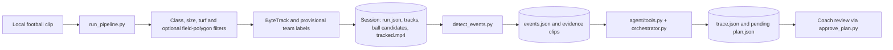
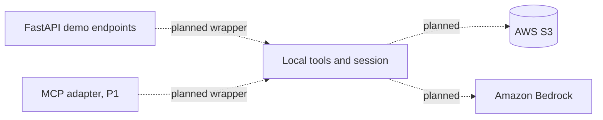

# TactiFrame architecture

This page separates the **running local path** from the planned Agentic Vision engine. The [Product Vision and Backlog](PRODUCT_VISION_AND_BACKLOG.md) defines the future agent roles, production boundaries, simulation plan, and club-pilot path. [EVAL.md](EVAL.md) records measured runs and limitations.

## Running local path



### SEE — observation

`run_pipeline.py` uses OpenCV 5 for video I/O and overlays, football-specific YOLO weights for class-limited detection, and Supervision ByteTrack for player tracking. `cv/detection_filter.py` applies filters **before** tracking. `cv/field_polygon.py` can use clip-specific manual polygon keyframes; it checks the input checksum and frame size. The run logs software versions, model hash, settings, filter counts, and output counts in `run.json`. Team labels and ball positions are provisional.

### UNDERSTAND — candidate events

`detect_events.py` reads a completed observation session and creates `events.json` plus short `clips/` evidence files. `cv/event_detector.py` currently emits `zone_density` and `zone_contest`. `cv/zones.py` assigns `r0c0`–`r2c2` on an image-relative 3×3 grid. Those IDs are not real pitch coordinates and the events are not football actions such as passes or turnovers. The [event contract](EVENT_CONTRACT.md) fixes these meanings.

### DECIDE — agent tools and trace

`agent/tools.py` owns six operations: `run_perception`, `list_events`, `get_clip`, `analyze_zone`, `draft_plan`, and `request_approval`. It enforces `list_events` before `draft_plan`. `agent/orchestrator.py` uses the observed candidate event mix to choose `get_clip` or `analyze_zone` next, then checks the other evidence view. Each call and choice is appended to `trace.json`. [AGENT_LOOP.md](AGENT_LOOP.md) shows the two real local sequences that took different next steps.

### ACT — coach approval

The proposed `plan.json` begins as `pending_approval`. `run_agent.py` requests review but does not approve it. A coach can use `approve_plan.py` to record an explicit approved or rejected decision after inspecting the evidence. No real coach decision has been recorded for the local test runs.

## Session files

```text
data/sessions/<run-id>/
  run.json
  tracks.json
  tracks_with_teams.json
  ball_observations.json
  tracked.mp4
  events.json
  clips/
  trace.json
  plan.json
```

The observation files appear first; `events.json` and clips appear after event detection; the trace and plan appear after the agent run. Sessions, video, model weights, and clip-specific calibration files are ignored by Git. The current footage and derived outputs are for local simulation and education only; see [ASSETS.md](ASSETS.md).

## Submission architecture still to build



The local adapters in `aws/storage.py` and `agent/bedrock.py` now upload private session evidence and generate an evidence-bound coach-review proposal after an OpenCV event is selected. Their real-account validation remains outstanding; see [AWS_SETUP.md](AWS_SETUP.md). FastAPI can provide upload, session, event, clip, and approval endpoints; it should delegate to the same tool layer. MCP is P1 and should wrap the same six tools without a second implementation. NVIDIA VSS/Cosmos is a later optional evidence layer, not part of the current local CV path. A full React or Next.js frontend is unnecessary for the qualifying scripted demo.

The [hackathon checklist](HACKATHON.md) is a target plan, including ideas that are not yet implemented. It should not be read as a list of files already shipped.
