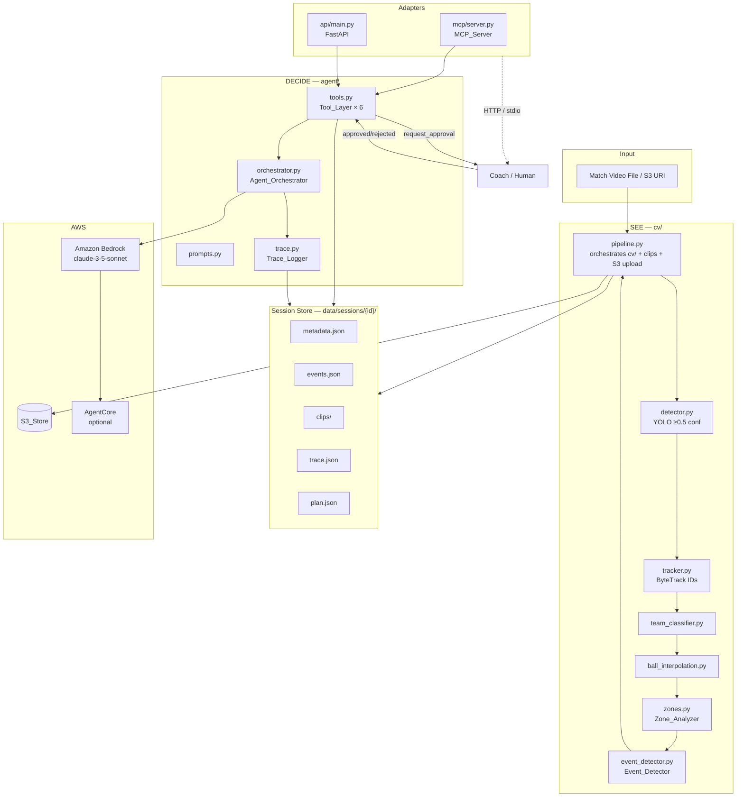

# TactiFrame — Architecture

> **Mostly planned design, not an implementation inventory (11 October 2026).** The observation worker in `run_pipeline.py` and `cv/tracker.py` completed full-duration technical runs on local simulation footage. `detect_events.py`, `cv/event_detector.py`, and `cv/zones.py` add unverified candidate visual events, image-relative zones, and local clips. `agent/tools.py`, `agent/orchestrator.py`, `run_agent.py`, and `approve_plan.py` now provide a local vision-driven tool sequence, trace, and coach approval path. A separately cleared clip is needed for public submission. API, AWS integration, and MCP described below are not implemented.

## Overview

TactiFrame converts raw match video footage into evidence-backed tactical intelligence through a four-phase pipeline:

**SEE → UNDERSTAND → DECIDE → ACT / COACH APPROVAL**



---

## Components

### cv/ — Perception Layer

| File | Role |
|---|---|
| `detector.py` | YOLO-based player and ball detection (confidence ≥ 0.5) |
| `tracker.py` | ByteTrack multi-object tracker — assigns persistent player IDs across frames |
| `team_classifier.py` | Classifies each player track into team A or team B by jersey colour |
| `ball_interpolation.py` | Fills gaps in ball position tracks using linear interpolation |
| `zones.py` | Zone_Analyzer — maps player positions to Pitch_Zone IDs on a configurable grid |
| `event_detector.py` | Event_Detector — converts frame-level tracks into discrete football events |
| `pipeline.py` | Perception_Engine — orchestrates the full cv/ stack, extracts evidence clips, uploads to S3, writes session JSON |

Current observation work adapts the upstream `cv/tracker.py` and `run_pipeline.py`; upstream `cv/detector.py` and `cv/pipeline.py` are empty placeholders. The remaining components in this section are planned.

### agent/ — Decision Layer

| File | Role |
|---|---|
| `tools.py` | Tool_Layer — single source of truth for all six tools: `run_perception`, `list_events`, `get_clip`, `analyze_zone`, `draft_plan`, `request_approval` |
| `orchestrator.py` | Agent_Orchestrator — Bedrock Converse reasoning loop; up to 10 iterations; optional AgentCore routing |
| `prompts.py` | System prompt for Bedrock instructing the agent to use TactiFrame tools to form hypotheses and draft a tactical plan |
| `trace.py` | Trace_Logger — records every tool call, hypothesis change, approval decision, and plan version to `trace.json` |

### api/ — HTTP Adapter

`api/main.py` is a FastAPI application exposing five endpoints:

- `POST /analyse` — accepts video path, returns session ID, runs pipeline in background
- `GET /events/{session_id}` — returns all detected events for a session
- `GET /clip/{event_id}` — returns local path and S3 URL for an evidence clip
- `POST /approve/{session_id}` — records the coach's approval or rejection decision
- `GET /session/{session_id}` — returns session metadata and plan status

All business logic delegates to `agent/tools.py`; the API is a thin HTTP adapter only.

### mcp/ — MCP Adapter

`mcp/server.py` uses the `FastMCP` class from the `mcp` Python SDK. It registers all six Tool_Layer functions with `@mcp.tool()` decorators by importing them directly from `agent/tools.py`. No logic is duplicated. Supports `stdio` and `streamable-http` transports.

### aws/ — Deployment Configuration

| File | Role |
|---|---|
| `apprunner.yaml` | AWS App Runner service definition |
| `lambda_handler.py` | Mangum-based Lambda container shim for the FastAPI app |

### Session Store — data/sessions/{id}/

Each analysis session is isolated in its own UUID-named directory:

```
data/sessions/{session_id}/
├── metadata.json      # session status, video path, S3 URL, events_reviewed flag
├── events.json        # list of detected Event objects
├── clips/             # extracted evidence clip video files
├── trace.json         # full reasoning trace (tool calls, hypotheses, plan versions)
└── plan.json          # current plan with status (pending_approval / approved / revision_required)
```

---

## Data Flow

1. A video file path is submitted via `POST /analyse` or `run_perception()`.
2. The video is uploaded to S3 under `sessions/{session_id}/video.*`.
3. `run_pipeline()` runs YOLO detection → ByteTrack → team classification → ball interpolation → zone assignment → event detection.
4. For each detected event, a 4-second evidence clip is extracted and uploaded to S3.
5. Results are written to `data/sessions/{session_id}/`.
6. The Agent_Orchestrator drives a Bedrock Converse loop: it calls `list_events`, forms hypotheses, calls `analyze_zone`, then calls `draft_plan`.
7. `draft_plan` enforces the evidence-first gate (list_events must be called first).
8. `request_approval` presents the plan to the Coach and blocks until a decision is received.
9. The Trace_Logger serialises the full reasoning trace to `trace.json`.

---

## Key Design Decisions

1. **Single Tool_Layer** — All business logic lives in `agent/tools.py`. MCP and FastAPI are thin adapters with zero duplicated logic.

2. **Bedrock Converse API** — Model-agnostic loop that swaps foundation models by changing `BEDROCK_MODEL_ID`. AgentCore is opt-in via `AGENTCORE_ENABLED`.

3. **File-based sessions** — UUID-isolated directories under `data/sessions/` are reproducible, inspectable, and require no database setup.

4. **Evidence-first hard gate** — `draft_plan` checks `metadata.events_reviewed` before invoking the orchestrator. Both adapters inherit this gate automatically.

5. **Build on observations** — The adapted TactiScout-CV observation worker is the starting point; zone assignment, event detection, and clip extraction remain to be built.
